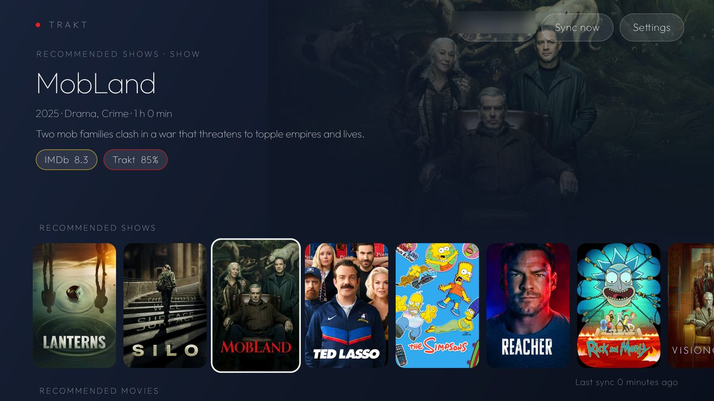

# Trakt shelf

Your Trakt account on the TV, in the launcher's language: a slate home with **Up next**, **Recommended
shows**, **Recommended movies**, **Watchlist**, **Trending** and **Recently watched** as rows of posters, the
focused title named in large type over its backdrop with IMDb, Rotten Tomatoes and Trakt ratings, and a details
page whose **Play** goes to Stremio, CloudStream or NetMirror, **Trailer** to TizenTube or SmartTube.

It also feeds the launcher: with `"hero_feed": true` in a theme, the launcher's top shelf cycles through these
titles while the dock is at rest, read from this app's content provider (no network in the launcher).



## What it does

| Part | How |
|---|---|
| Sign in | Trakt's device flow on the TV: a code and `trakt.tv/activate`; approve on your phone. No browser on the TV, no client secret anywhere. Tokens refresh on their own; a refused refresh asks you to sign in again. |
| Sync | Every 6 hours while the TV is online (JobScheduler), after sign-in, and from Settings → Sync now. Trending needs no account. Up next, recommendations, watchlist and history need one. |
| Details | Posters (TMDB w342), backdrops (w780), synopsis, genres, runtime, top-five cast and a trailer from TMDB; IMDb rating and Rotten Tomatoes from OMDb; Trakt's own rating. Cached seven days per title. |
| Cache | `files/feed.json`, `files/meta.json` and `files/img/`, trimmed to 140 MB by age. |
| Play | By IMDb id: Stremio's deep link (`stremio:///detail/movie/tt…/tt…`, and the next episode for a show), CloudStream's search (`cloudstreamsearch://title`), or NetMirror's home screen. A chooser when more than one is installed; Settings → Default player skips it. |
| Trailer | A YouTube watch URL to TizenTube when it is installed, SmartTube otherwise, with no chooser; when neither is there and more than one other app takes YouTube links, a chooser among those. |
| Settings | Account, Sync now, Default player (Ask each time or one of the installed players), **Carousel rows** (a tick list: Up next, Recommended shows, Recommended movies, Watchlist, Trending, Recently watched; all but Recently watched by default), **Carousel items** (6, 9, 12, 15 or 20; 12 by default), **Watchlist order** (Date added, newest first, or Release date, the titles still to come soonest first and then the released ones newest first; the Home row and the carousel's watchlist items both follow it), Sign out. Kept in SharedPreferences; a change notifies the provider's observers, so the launcher's shelf follows at once. |
| Writes | Add to / remove from watchlist, mark watched (a show's next episode, or the movie). |
| Provider | `content://com.kupraki.traktshelf.hero/items`, read-only, exported: `_id`, `kind`, `title`, `year`, `synopsis`, `imdb_rating`, `rt_rating`, `trakt_rating`, `imdb_id`, `trakt_id`, `poster_path`, `backdrop_path` (both `content://…/image/{poster,backdrop}/<_id>`, opened with `ContentResolver.openInputStream`), `source_row`, `rank`, `meta`, `next_episode`. As many items as Settings → Carousel items asks (12 by default), from the rows ticked there, Up next first, each row with its share and the leftover in row order; observers are notified after every sync and after a Settings change. |
| Card | Label "Trakt", caption "Up next and picks", accent `#ED1C24`. |

## Keys

Register a Trakt API app at [trakt.tv/oauth/applications](https://trakt.tv/oauth/applications) (redirect URI
`urn:ietf:wg:oauth:2.0:oob`), a [TMDB](https://www.themoviedb.org/settings/api) key (v3 key or v4 read token)
and an [OMDb](https://www.omdbapi.com/apikey.aspx) key, and put them in a file the build reads and git ignores,
by default `work/secrets.env` at the repository root:

```
TRAKT_CLIENT_ID=…
TMDB_API_KEY=…
OMDB_API_KEY=…
```

`-PsecretsFile=/path/to/file` or `SECRETS_FILE=…` points the build elsewhere. Without the file the app builds
with empty keys and the sign-in screen says so.

## Build and install

```bash
cd addons/traktshelf && ./gradlew assembleRelease && cd ../..
TV_HOST=<tv ip> tools/venv/bin/python -I tools/b64push.py addons/traktshelf/app/build/outputs/apk/release/app-release.apk /data/local/tmp/traktshelf.apk
TV_HOST=<tv ip> tools/venv/bin/python -I tools/tv.py 'pm install -r /data/local/tmp/traktshelf.apk; rm -f /data/local/tmp/traktshelf.apk'
```

Then open **Trakt** on Home, press **Sign in**, and enter the code at `trakt.tv/activate`. Check the provider
from a shell: `tools/tv.py 'content query --uri content://com.kupraki.traktshelf.hero/items'`.

## Permissions

| Permission | Why |
|---|---|
| `INTERNET` | api.trakt.tv, api.themoviedb.org, image.tmdb.org, www.omdbapi.com. Nothing else. |
| `ACCESS_NETWORK_STATE` | JobScheduler's "only while online" constraint for the six-hourly sync. |

No analytics, no background service: the sync is a JobScheduler job and a thread while the app is open.

## Tested on

Xiaomi Mi TV 4A (MiTV-MOOQ1), Android TV 10, 1 GB class: a full account sync of 82 titles takes about a
minute and the app sits at 55 to 60 MB PSS with the rows on screen.

## Dependencies

`androidx.recyclerview` for the poster rows. Networking is `HttpURLConnection`, JSON is `org.json`, the
periodic sync is JobScheduler; the Outfit typeface is under the SIL Open Font License (`FONT-LICENSE-OFL.txt`).
This project uses the TMDB API but is not endorsed or certified by TMDB.
